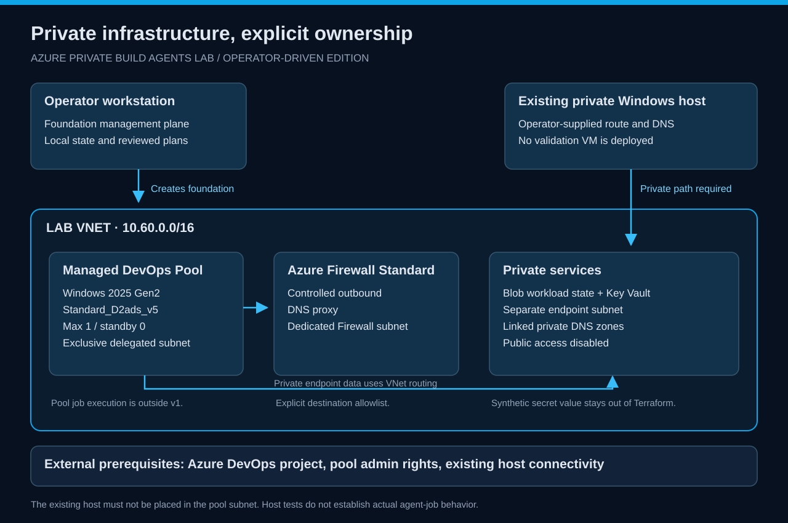

# Azure Private Build Agents Lab

A Terraform-first lab for the **Azure infrastructure behind private Windows build agents**. It deploys a Managed DevOps Pool into your VNet, Azure Firewall for controlled outbound access, and private endpoints for Blob state and Key Vault.

This version is operator-driven. It contains **no pipeline definitions or pipeline setup walkthrough**. Pool provisioning and private infrastructure checks are in scope; running a build job on an actual Managed DevOps agent is outside version 1.

*The pool uses a delegated subnet. Private services stay private, while approved outbound traffic uses Azure Firewall.*

## What you learn

- Provision and inspect a Windows Managed DevOps Pool with one maximum agent and no standby.
- Separate operator permissions, pool identity, and service network permissions.
- Resolve private service names through the Firewall DNS proxy.
- Use a private Blob Terraform backend through Microsoft Entra authentication.
- Seed a synthetic Key Vault secret, remove temporary write access, and prove read access.
- Apply a small workload, inspect a no-change plan, and exercise deterministic state locking.
- Diagnose DNS and RBAC failures, then destroy resources in dependency order.

## Lab shape

| Component | Baseline |
| --- | --- |
| Infrastructure | Terraform **1.16.4**, AzureRM **5.6.0** |
| Pool image / size | <code>windows-2025-g2</code> / <code>Standard_D2ads_v5</code> |
| Capacity | Maximum one agent; zero standby |
| VNet | <code>10.60.0.0/16</code>, dedicated pool, endpoint, and Firewall subnets |
| Egress / DNS | Azure Firewall **Standard**, DNS proxy |
| Foundation state | Local, independent of the private workload backend |
| Workload state | Private Blob container, Microsoft Entra data-plane access |
| Private targets | Blob storage and Key Vault, public network access disabled |
| Operator tools | PowerShell 7.4+, Azure CLI and Terraform |
| Private validation host | An **existing Windows host** with a working private network/DNS path |

The repository does not deploy a validation VM, VPN or Bastion. You must supply the private-connected host for data-plane exercises. A workstation with internet access alone is insufficient.

## Start here

1. Read [setup](docs/setup.md), [identity](docs/identity.md), and [costs](docs/costs.md).
2. Follow the [ten guided exercises](wiki/exercises/README.md).
3. Use [troubleshooting](docs/troubleshooting.md) and [cleanup](docs/runbooks/cleanup.md).
4. Record actual outcomes in [validation status](docs/validation-status.md).

The source is published on [GitHub](https://github.com/Jamonygr/azure-private-build-agents-lab). Cloud deployment, live validation and actual pool-job execution have not been performed.

## Local quick start

Run in PowerShell 7.4+ from the repository root:

~~~powershell
$labId = 'pbalab'
$subscriptionId = '<your-disposable-subscription-guid>'
New-Item -ItemType Directory -Force .local | Out-Null
Copy-Item terraform.tfvars.example .local/lab.tfvars
# Edit .local/lab.tfvars with your identifiers and operator principal.
./scripts/Invoke-Lab.ps1 -Action Preflight -LabId $labId -SubscriptionId $subscriptionId
~~~

The helper defaults to preview/offline guards. Live operations require <code>-Execute</code>.

~~~powershell
./scripts/Invoke-Lab.ps1 -Action Preflight -LabId $labId -SubscriptionId $subscriptionId -Execute
./scripts/Invoke-Lab.ps1 -Action Plan -LabId $labId -SubscriptionId $subscriptionId -Execute
# Inspect the saved plan before applying.
./scripts/Invoke-Lab.ps1 -Action Apply -LabId $labId -SubscriptionId $subscriptionId -Execute
./scripts/Invoke-Lab.ps1 -Action Export -LabId $labId -SubscriptionId $subscriptionId -Execute
~~~

The foundation owns its local state at <code>.local/state/foundation-&lt;lab-id&gt;.tfstate</code>. The separate <code>workload/</code> root uses private Blob state from the existing private host. Follow [setup](docs/setup.md) before either deployment.

## Repository map

~~~text
.
|-- *.tf                  Foundation orchestration and export contract
|-- environments/         Tracked lab configuration
|-- modules/              Reusable infrastructure modules
|-- workload/             Independent sample and private Blob backend
|-- scripts/              Operator lifecycle and validation helpers
|-- tests/                Offline behavior and policy checks
|-- docs/                 Operator procedures and runbooks
|-- wiki/                 Book, architecture, ten exercises and diagrams
+-- .local/               Ignored inputs, local state, plans and evidence
~~~

Generated Terraform references describe the actual inputs and outputs. Keep local inputs, state and binary plans out of Git.

## Documentation

[Wiki home](wiki/README.md) · [Book](wiki/book.md) · [Architecture](wiki/architecture/overview.md) · [Exercises](wiki/exercises/README.md) · [Testing](docs/testing.md) · [Reference](docs/reference.md) · [Security](SECURITY.md) · [Contributing](CONTRIBUTING.md)

This is a learning environment, not a production platform. Firewall and other foundation resources continue to cost money while the pool is idle. [Cost guide](docs/costs.md).

Released under the [MIT License](LICENSE).
