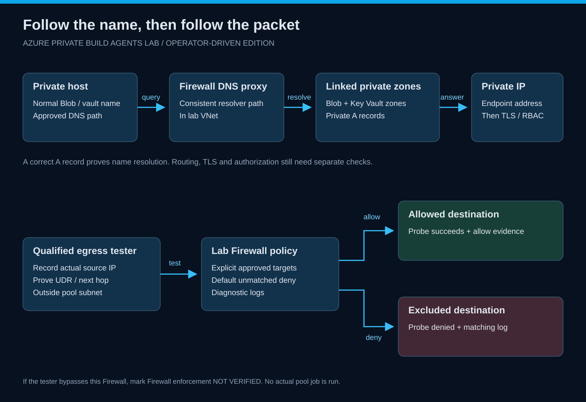

# DNS, private access and outbound access

[Home](../README.md) · [Monitoring](monitoring.md) · [Exercise 8](../wiki/exercises/08-egress.md)

*Private service names use linked private zones through the Firewall proxy. Approved public destinations use the Firewall policy.*

## Pool network

Managed DevOps Pools exclusively owns its delegated subnet. **Do not put the validation host or any unrelated resource in that subnet.**

The pool's private endpoint path and outbound route are represented in Terraform. A running agent would need service coordination and tool-download connectivity as well as private service access. This version inspects pool configuration; it does not execute an agent job.

## Existing validation host

The operator host needs private routing and DNS visibility to Blob/Key Vault. To make a claim about the lab Firewall's egress behavior, its tested outbound traffic must actually traverse this Firewall. A host connected through VPN may use a different internet route.

Record its source IP and route path. If egress bypasses the lab Firewall, record the probe as host-only connectivity and leave Firewall enforcement **not verified**. Do not relabel that result as pool-agent validation.

## DNS sequence

1. Query the normal Blob or Key Vault hostname.
2. Use the lab Firewall DNS proxy or an approved resolver path with equivalent access to the linked private zones.
3. Verify the resulting A record equals the exported endpoint IP.
4. Test TLS/data access to the same normal hostname.

DNS resolution, routing, TLS and data-plane authorization are separate checks. A 403 is not a DNS failure; an unresolved hostname does not diagnose RBAC.

See [Firewall DNS settings](https://learn.microsoft.com/en-us/azure/firewall/dns-settings) for proxy behavior.

## Outbound policy

Read the explicit allowlist before introducing another package source. Add a hostname only after reproducing the blocked dependency and determining its purpose.

The egress helper probes an allowed and an intentionally excluded destination. Correlate its source IP, destination and timestamp with Firewall logs. A timeout alone is insufficient evidence of a policy deny.

Do not add an unrestricted destination wildcard, remove the route or enable public access on the targets to make a lab exercise pass.

## Optional tool prerequisites for the egress exercise

The egress helper needs the Azure CLI **azure-firewall** and **log-analytics** extensions. Other lab helpers do not need them. Inspect existing installations first:

~~~powershell
az extension show --name azure-firewall --output table
az extension show --name log-analytics --output table
~~~

If missing, install them explicitly as an operator preparation step, then recheck:

~~~powershell
az extension add --name azure-firewall
az extension add --name log-analytics
~~~

The helper does not silently install extensions. Missing or uninspectable dependencies produce INCOMPLETE before it probes. See the official [Firewall CLI reference](https://learn.microsoft.com/en-us/cli/azure/network/firewall?view=azure-cli-latest) and [Log Analytics query reference](https://learn.microsoft.com/en-us/cli/azure/monitor/log-analytics?view=azure-cli-latest).
## Allowlist inventory

Reviewed **2026-09-27** against <code>modules/egress/main.tf</code>. These are configured dependencies, not evidence that a managed agent job used them.

| Category | Configured destinations | Protocol / purpose |
| --- | --- | --- |
| MDP startup | <code>*.prod.manageddevops.microsoft.com</code>, <code>rmprodbuilds.azureedge.net</code>, <code>*.queue.core.windows.net</code> | Explicit HTTPS 443 service dependencies |
| DevOps coordination and artifacts | <code>download.agent.dev.azure.com</code>, <code>dev.azure.com</code>, <code>vssps.dev.azure.com</code>, <code>vsrm.dev.azure.com</code>, <code>*.vsassets.io</code>, <code>*.vsblob.vsassets.io</code> | Explicit HTTPS 443 |
| Organization endpoints | Selected organization prefix with <code>.visualstudio.com</code>, <code>.services.visualstudio.com</code>, <code>.vsblob.visualstudio.com</code>, <code>.vssps.visualstudio.com</code> | Explicit HTTPS 443 |
| Microsoft identity / management | <code>login.microsoftonline.com</code>, <code>management.azure.com</code>, <code>graph.microsoft.com</code>, <code>pas.windows.net</code>, <code>management.core.windows.net</code> | Explicit HTTPS 443 |
| Terraform distribution / registry | <code>releases.hashicorp.com</code>, <code>registry.terraform.io</code>, <code>checkpoint-api.hashicorp.com</code> | Explicit HTTPS 443 |
| Windows update | Azure Firewall <code>WindowsUpdate</code> FQDN tag | Rule declares HTTPS 443; Microsoft manages destinations and can include required HTTP 80 endpoints |

The WindowsUpdate tag is not a fixed HTTPS-only hostname list. Microsoft documents the managed HTTPS/HTTP behavior in [Azure Firewall FQDN tags](https://learn.microsoft.com/en-us/azure/firewall/fqdn-tags). Review tag changes as part of outbound-policy maintenance; do not claim every permitted connection is HTTPS-only.

Approved service-domain wildcards are bounded dependencies, not an unrestricted <code>*</code> destination rule. The controlled negative probe uses a destination outside this list.

## Extend deliberately

New images, tools and package managers can require additional endpoints. Document each added dependency and rerun allowed/denied probes from the relevant path. A working private-host download still does not establish the managed agent's runtime behavior.
