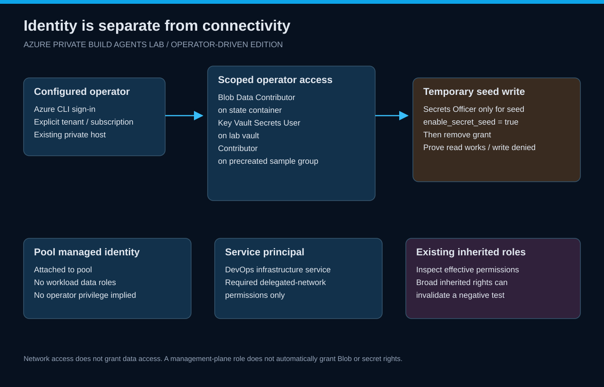

# Identity and authorization

[Home](../README.md) · [Setup](setup.md) · [Secret seed](runbooks/secret-seed.md)

*The operator uses Azure CLI authentication. Pool identity and the service's delegated-network permissions are separate responsibilities.*

## Actors

| Actor | Responsibility | Boundary |
| --- | --- | --- |
| Foundation operator | Resource creation, role assignments, pool configuration and cleanup | Explicit tenant/subscription and protected local state |
| Configured operator principal | Private-host workload, Blob state and synthetic-secret read | Narrow data roles and sample-resource-group scope |
| Pool managed identity | Identity attached to the pool | No implied operator or deployment privileges |
| DevOps infrastructure service principal | Pool infrastructure and subnet integration | Required network permissions for the service |

The same human can be the foundation operator and private-host operator, but their effective rights still need inspection. An inherited subscription-wide role can invalidate a meaningful least-privilege test.

## Operator role intent

- **Storage Blob Data Contributor** on the workload state container.
- **Key Vault Secrets User** for normal synthetic-secret reads.
- **Contributor** on the sample resource group precreated by the foundation.
- Temporary **Key Vault Secrets Officer** only when <code>enable_secret_seed = true</code>.

The sample group must exist before the workload runs. Contributor inside that group does not authorize creating a new resource group. Do not compensate by broadening the grant.

## Verify identity

On the existing private Windows host:

~~~powershell
$c = Get-Content .local/lab-config.json -Raw | ConvertFrom-Json
az account set --subscription $c.subscription_id
az account show --query '{subscription:id,tenant:tenantId}' --output json
az ad signed-in-user show --query id --output tsv
az role assignment list --assignee $c.operator_principal_id --all --include-inherited --output table
~~~

Compare the principal with <code>operator_principal_id</code>. For a non-user login, inspect that identity's principal record instead of using <code>az ad signed-in-user</code>.

## Seed and revoke

Enable the temporary seed setting, review/apply the role change locally, export fresh configuration, and transfer that export to the private host. Seed only the synthetic secret, then disable the setting and reapply.

Prove both role removal and a denied write using the private host. Account for bounded RBAC propagation delay; do not add permissions to hide a failed revocation test.

## What is outside this version

No workload identity federation, service connection or automated deployment flow is configured. The lab provisions the pool infrastructure and tests private resources through the supplied Windows host. Pool job authentication and execution need their own later design and validation.
