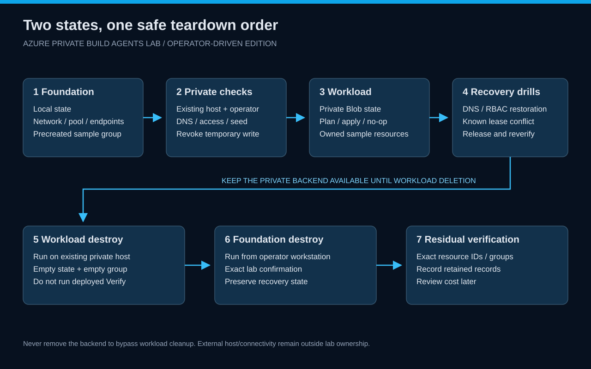

# Ordered cleanup and residual verification

[Home](../../README.md) · [Exercise 10](../../wiki/exercises/10-cleanup.md)

*Destroy the sample through its private backend before deleting the infrastructure that provides access to that backend.*

## 1. Freeze changes

Stop concurrent Terraform operations. Record lab ID, tenant/subscription and the two state locations. Preserve the foundation state and matching export until cleanup is verified.

## 2. Destroy the workload from the existing private host

~~~powershell
./scripts/Invoke-Workload.ps1 -Action Destroy -ConfigPath .local/lab-config.json -LabId $labId -SubscriptionId $subscriptionId -Execute -Confirmation "DESTROY $labId"
$c = Get-Content .local/lab-config.json -Raw | ConvertFrom-Json
az resource list --resource-group $c.workload_resource_group_name --query 'length(@)' --output tsv
~~~

Expected: the sample resources are absent and the resource group is empty. Do not delete the foundation or backend to bypass a workload error.

## 3. Destroy the foundation locally

~~~powershell
./scripts/Invoke-Lab.ps1 -Action Destroy -LabId $labId -SubscriptionId $subscriptionId -Execute -Confirmation "DESTROY $labId"
./scripts/Invoke-Lab.ps1 -Action VerifyCleanup -LabId $labId -SubscriptionId $subscriptionId -Execute
~~~

The helper checks scope and refuses foundation teardown if the sample group is nonempty. If Azure reports a transient service association or endpoint deletion dependency, inspect and wait for that deletion to finish before retrying.

VerifyCleanup reports **ACTIVE RESOURCES** for the two lab groups separately from **SOFT-DELETED VAULT**. It queries the exact lab vault: a retained record includes deletion and scheduled-purge dates; an absent record is reported explicitly. A denied or failed query is incomplete verification. The helper never purges the vault.

## 4. Review residuals

Check the named resource groups, pool and registered service-side pool entry as applicable, private endpoints, Firewall/public IP, private zones, storage and monitoring resources. Key Vault soft-deleted records may persist according to the configured protection behavior; distinguish retention from an active resource.

Do not purge a vault or delete an unrelated pool just because its name is similar. Use exact IDs from the matching export and record anything still retained.

## 5. Close the session

Keep a protected recovery copy of foundation state until absence is established. Save only sanitized cleanup evidence in a shareable report. Review Azure cost later for the full resource lifetime and any explicitly retained items.

A failed residual check means cleanup is unfinished. Preserve the necessary state and return to the failed layer.
