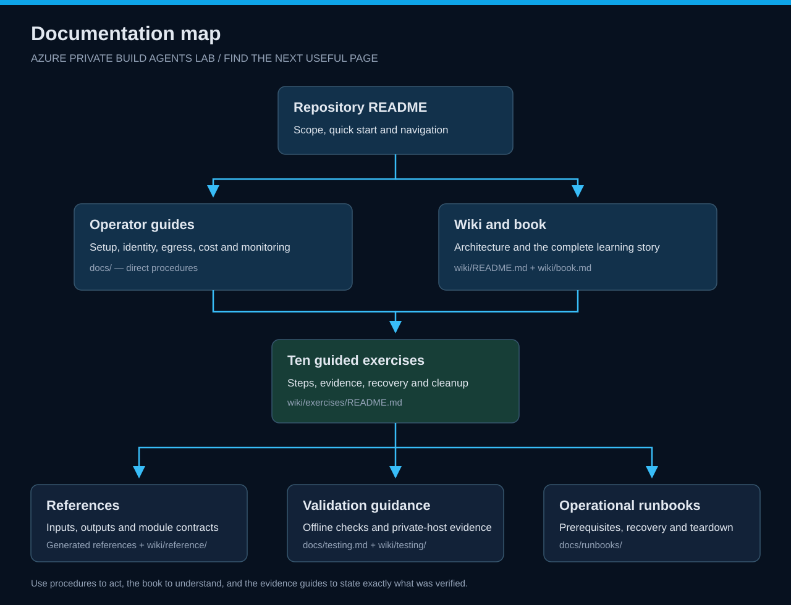

# Learning guide

[Repository home](../README.md) · [Book](book.md) · [Ten exercises](exercises/README.md)

This wiki explains the infrastructure behind private Windows build agents, then turns that architecture into observable operator tasks. It follows the teaching style of the Azure Landing Zone Lab: architecture first, small reproducible changes, evidence and cleanup.

*Start with the repository README, choose procedures or the learning narrative, then follow the ten exercises and use references, validation guidance and runbooks as needed.*

## Choose your route

| Goal | Start here |
| --- | --- |
| Read the complete story | [Book](book.md) |
| Understand resource boundaries | [Architecture](architecture/overview.md) |
| Complete hands-on work | [Ten exercises](exercises/README.md) |
| Find module responsibilities | [Module guide](modules/README.md) |
| Find commands and configuration | [Reference](reference/README.md) |
| Distinguish validation levels | [Testing guide](testing/lab-testing-guide.md) |
| Use this in a class | [Instructor workbook](certifications/lab-workbook.md) |

## Learning boundary

The lab provisions a Managed DevOps Pool, but ships no build/deployment pipeline. Private data-plane exercises run from an existing Windows host with an approved private path. That host must be outside the pool's exclusively delegated subnet.

A configured pool is not a successfully executed agent job. Keep this distinction in every result you record.

## Evidence convention

Each exercise states its execution location, prerequisites, steps, expected observations, troubleshooting and cleanup. Write **not run**, **blocked**, **failed** or **passed with evidence**; do not replace an untested result with a plausible explanation.

Keep credentials, state and secret values out of the workbook.
