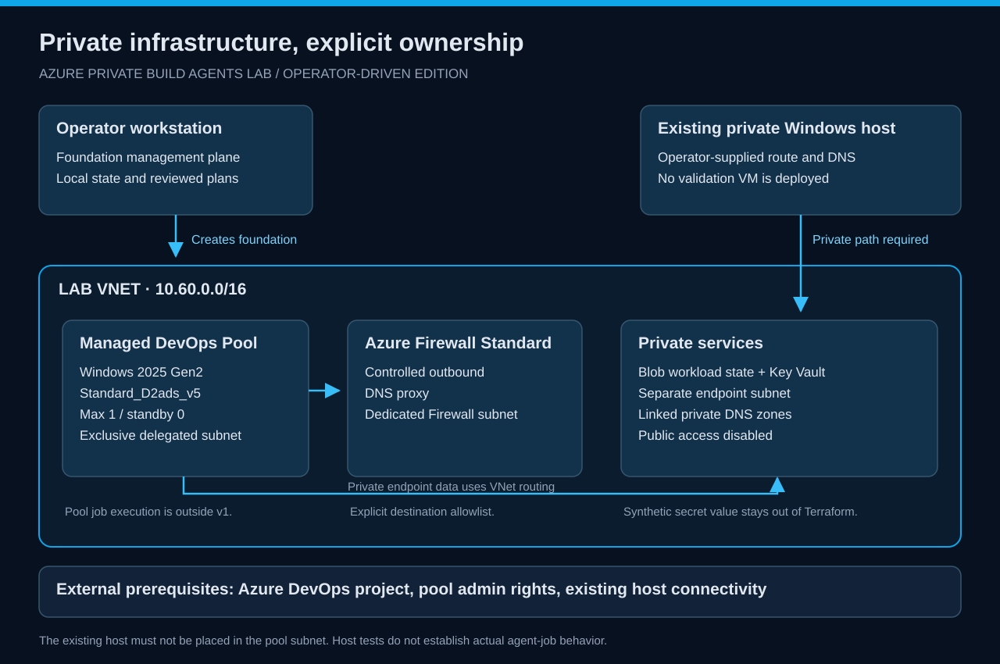
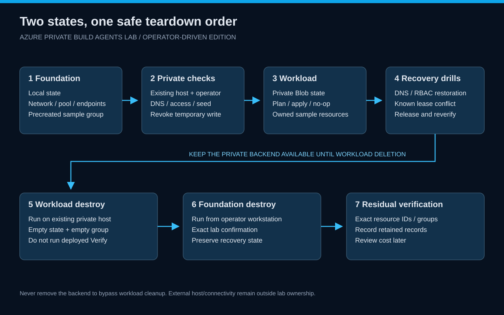

# Architecture and ownership

[Wiki](../README.md) · [Book](../book.md)

## Foundation

The repository root creates the lab's shared infrastructure: network, Firewall, private services, operator roles, monitoring, pool and its identity, plus an empty sample resource group.

Its Terraform state remains on the foundation workstation. This preserves a management-plane recovery path without requiring the private workload backend during initial deployment or final teardown.

## Pool

Managed DevOps Pools injects Windows compute into its dedicated delegated subnet. The selected image is <code>windows-2025-g2</code>, the SKU is <code>Standard_D2ads_v5</code>, maximum concurrency is one and no agent is held in standby.

Zero standby means the lab does not promise an immediately warm agent. This version inspects pool configuration without queueing a job or proving the managed image's runtime tools.

## Private services

Blob state and Key Vault have private endpoints in a separate subnet, with private DNS zones linked to the same VNet. Public network access remains disabled, including bootstrap. Azure Firewall Standard provides a DNS proxy and explicit outbound control.

## Operator host

You supply an existing Windows host that can resolve and route to the endpoints. The lab does not create that machine, place it in the pool subnet, or establish a VPN. For Firewall egress tests, prove that the host's outbound route uses the lab Firewall; private connectivity alone does not establish that fact.

## Workload

The independent <code>workload/</code> root creates a small network sample inside the precreated sample group. It uses private Blob state through Azure CLI / Microsoft Entra authentication. The configured operator receives the necessary data-plane and group-scoped roles.

## Ownership table

| Owner | Owns | Must not take over |
| --- | --- | --- |
| Foundation state | Shared infrastructure, sample group and role assignments | Existing validation host and its external connectivity |
| Workload state | Sample network resources | Its resource group, backend storage, vault or pool |
| Existing environment owner | Validation host and connection path | Lab resources outside the agreed scope |

This ownership split determines teardown order: workload first, foundation second, externally owned host unchanged.

