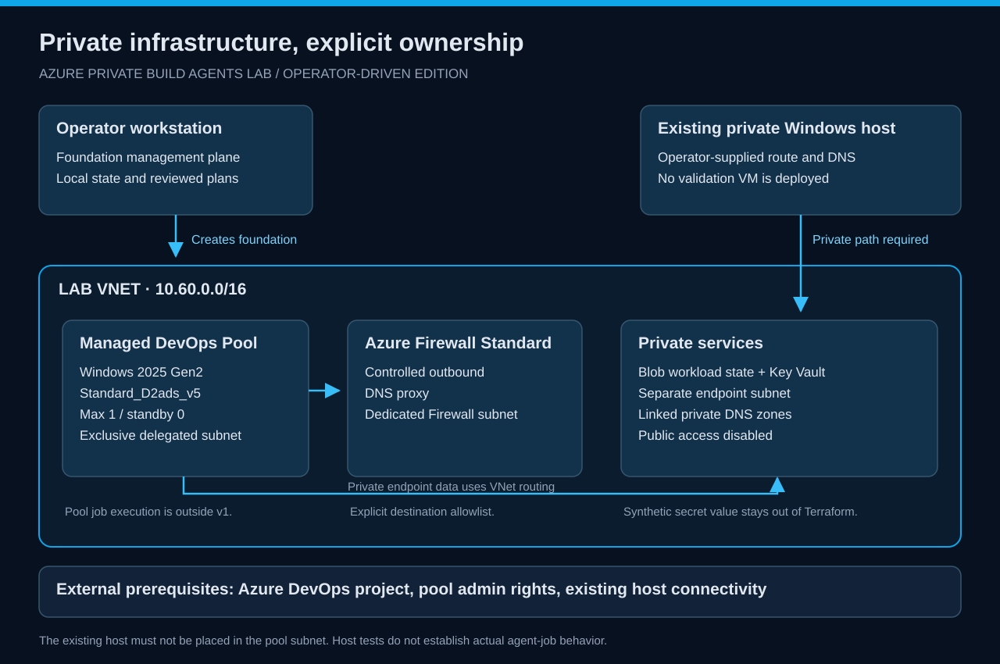
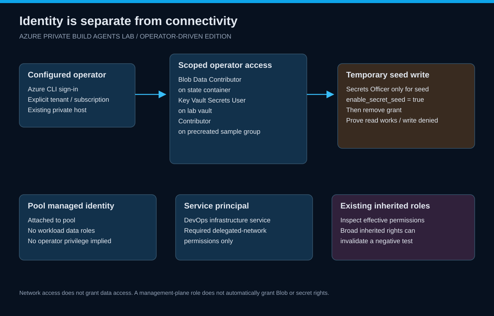
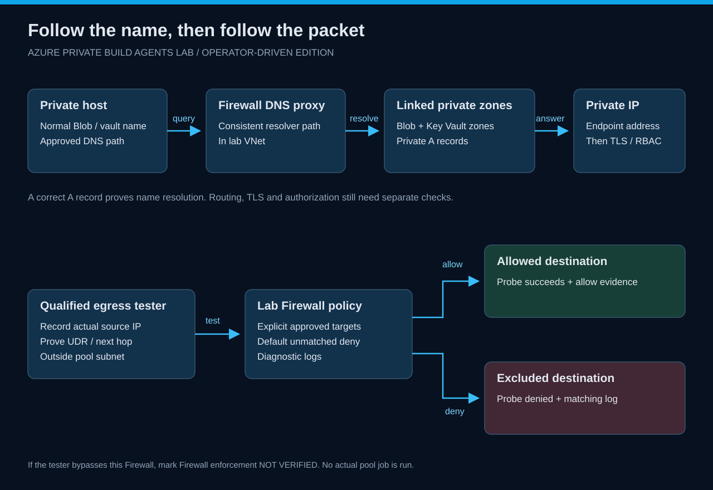
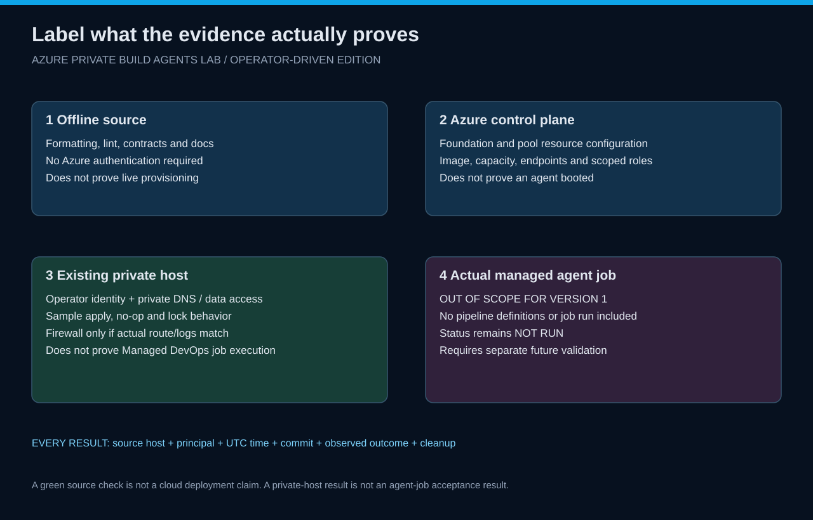
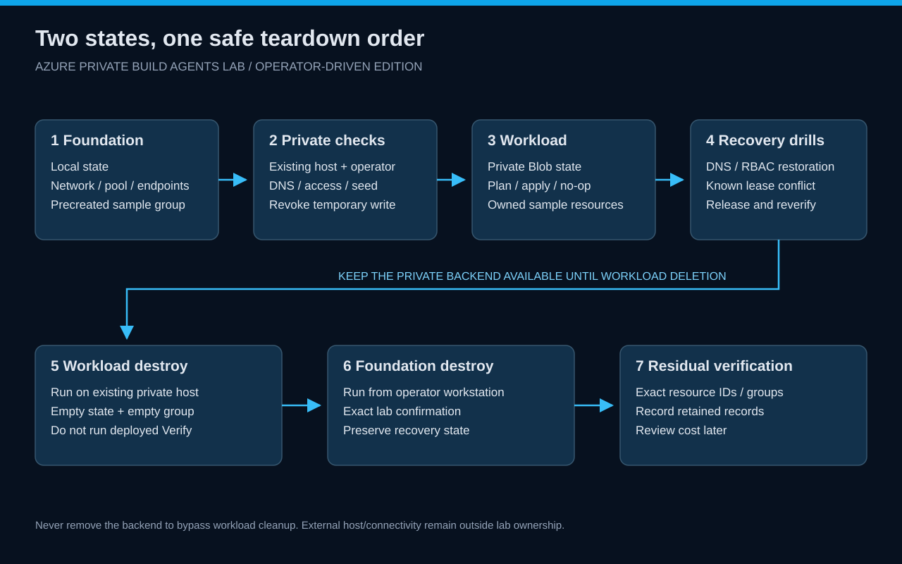

# Private build-agent infrastructure: the complete learning story

[Wiki](README.md) · [Exercises](exercises/README.md)

## 1. Start with the boundary you want to prove

A private agent is useful because it can reach private resources and use a deliberate outbound path. Placing a VM in a VNet is only part of that story. DNS must select the private endpoint, routes must carry traffic to it, TLS must address the intended service, and the signed-in principal must have the correct data-plane role.

This lab separates those questions so a failure has an explanation. It also separates infrastructure provisioning from job execution: the pool exists, but no pipeline or build job is included.

## 2. Keep the foundation recoverable

The root Terraform deployment creates the resources that later make private workload execution possible. Storing its state behind those same resources creates a dependency during bootstrap and teardown. Here the operator keeps foundation state locally, in an ignored lab-specific path, with a protected backup.

The workload has a different state lifecycle. Once the private path exists, its independent root uses Blob state through Microsoft Entra authentication. A state blob is operational data; its permissions and lease behavior matter just as much as the resources described by it.

**Think about:** who can recover the foundation if the private host becomes unavailable? Which state copy is authoritative? What would make two people accidentally operate the same state?

## 3. Use service-specific identities

The DevOps infrastructure service principal needs permission to integrate with the delegated subnet. The pool has a managed identity. The operator uses a user identity or another explicitly configured principal for manual tests. These actors do different jobs and should not share an assumed privilege set.

The operator receives Blob data access for state, read access to the synthetic secret, and Contributor inside a precreated sample group. That group boundary is intentional: the sample cannot create new groups or grant itself roles through the lab's scoped role.

**Think about:** does the tester also inherit broad subscription roles? If so, how much does a successful operation really prove about the intended narrow assignment?

## 4. Understand the pool without inventing a runtime result

A Managed DevOps Pool is not a user-managed VM to configure with RDP. The service manages its compute lifecycle. Your infrastructure choices include image, SKU, delegated network and capacity.

The lab sets one maximum agent and zero standby. A pool with no active compute can be behaving correctly. Inspecting those settings proves configuration only. Testing an existing private Windows host proves that host's path. Actual pool-agent startup and job execution require later validation outside this version.

## 5. Follow a name to its destination

Use the normal service name, such as the storage account's Blob hostname. Private DNS changes its resolved destination while the TLS hostname remains the expected service name.

The lab links the private zones to the VNet and uses Azure Firewall DNS proxy. A tester using a different DNS server may receive a public address even when the Azure resources are correctly configured. A correct A record is also insufficient by itself: the host needs a route to that address.

**Think about:** why does “the portal says private endpoint approved” fail to prove the client's DNS path?

## 6. Bootstrap a secret without making write permanent

The synthetic secret exists only to demonstrate private secret access. Terraform creates the vault and roles but does not store the secret value in its inputs/state.

A temporary flag grants the configured operator secret-writing rights. After the seed helper runs, the operator removes that flag and reapplies. The useful outcome is not merely “the secret exists”; it is “read works and write no longer works.”

Do not hide a failed negative test. An inherited role or cached authorization may still permit writes. Record the discrepancy, inspect effective access and rerun after bounded propagation.

## 7. Make Terraform behavior observable

A successful apply establishes that the operator could reach the private backend, acquire state access and create the sample resources. A later no-op plan checks convergence. A deterministic lease test checks what happens when another operation already owns the lock.

Do not race two full apply jobs and hope to create a lock collision. Hold a known lease through the lab helper, demonstrate the competing failure, release the owned lease in cleanup, and prove a normal operation can proceed.

## 8. Attribute outbound behavior accurately

Firewall policies should permit required endpoints and deny an intentionally excluded target. Yet a failed HTTP request might instead be a DNS error or unreachable route.

Correlate the tester's source IP, target and UTC time with a Firewall rule event. If the existing host uses a different default route, its request cannot establish the lab Firewall's behavior. That result stays host-only, and actual agent egress stays untested.

Avoid broad wildcard rules that erase the very boundary being studied.

## 9. Practice controlled recovery

A training failure needs a known cause and a reliable restoration path. A single query to an intentionally wrong DNS server is safer than changing an entire workstation's DNS settings. Temporarily removing one verified lab-scoped read role teaches RBAC failure only if you can restore it from the foundation definition.

Keep original evidence, change one layer, rerun the same probe and document recovery. Do not broaden public access or discard state to make errors disappear.

## 10. Finish in dependency order

The workload needs its private backend to destroy what it owns. Remove it while that path exists, prove the sample group is empty, then destroy the foundation. Keep state and the export until residual verification is complete.

The final lesson is operational: a deployment is not fully handled when it is merely created. Ownership, recoverability, evidence and cleanup complete the learning cycle.

Continue with the [ten exercises](exercises/README.md).
